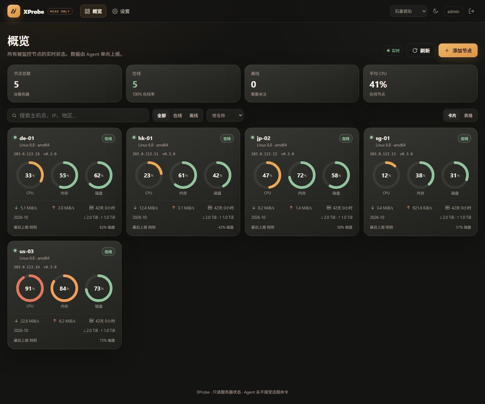
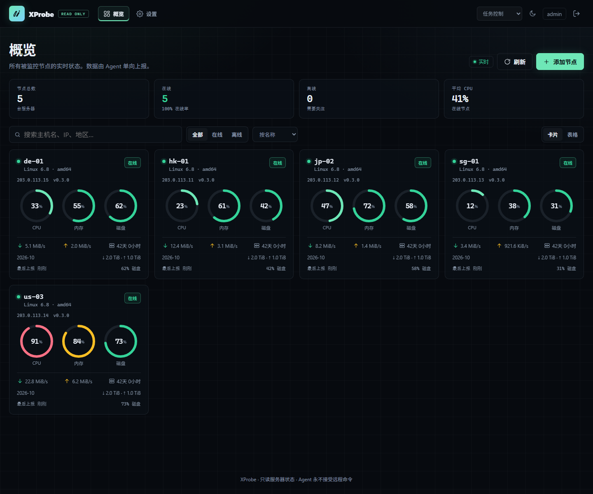
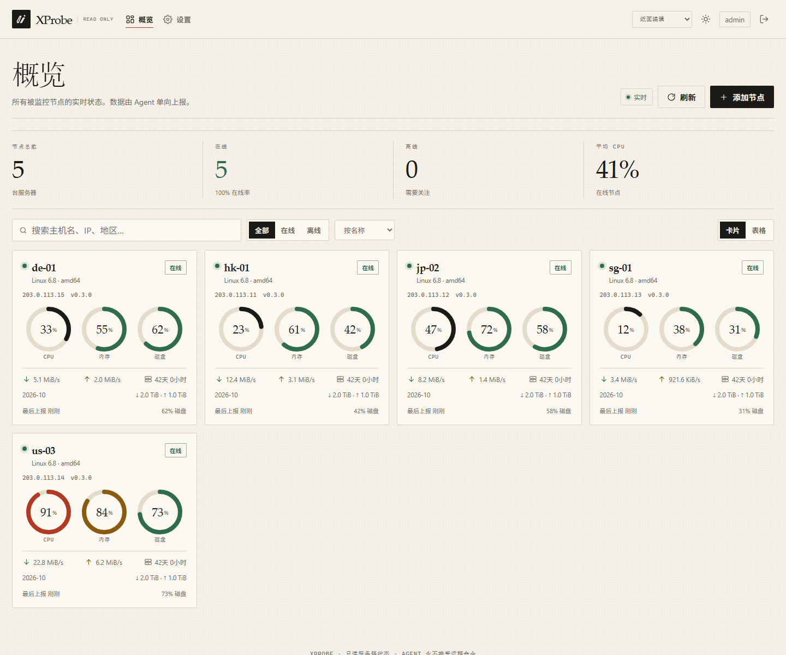
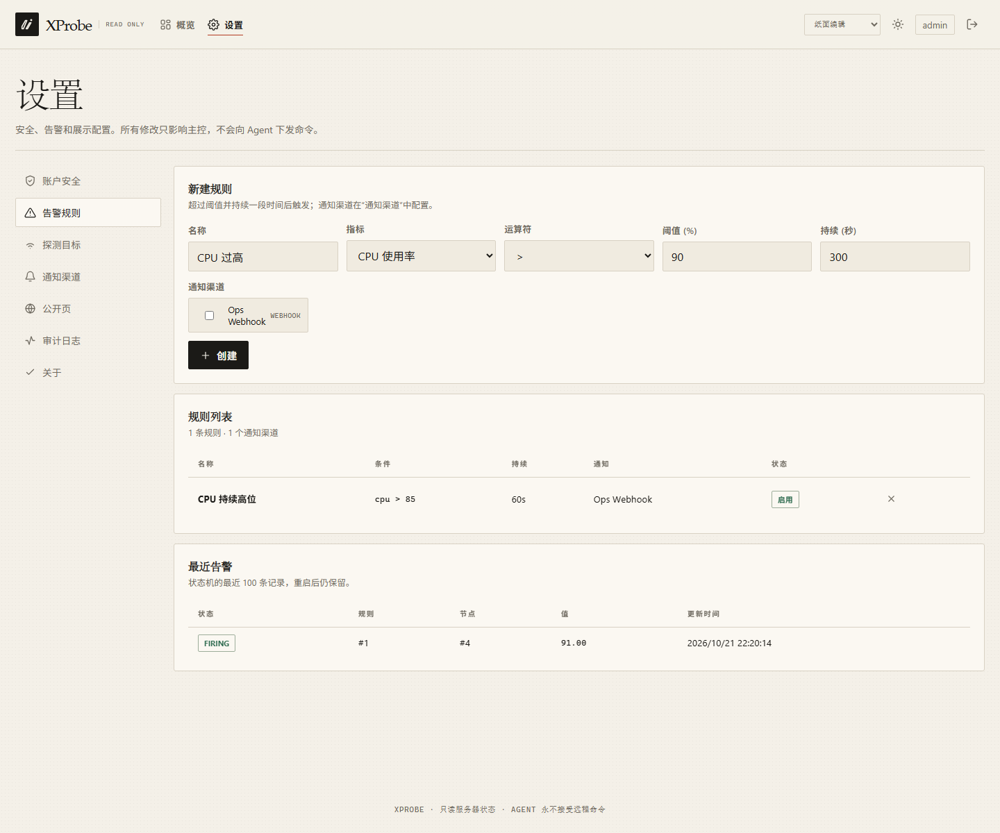
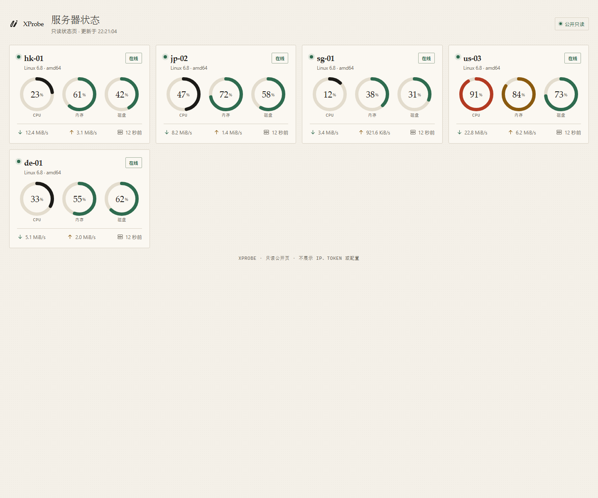

# XProbe

只读服务器探针。Agent 只采集和上报，主控不提供 WebSSH、文件管理、远程命令或定时任务，从架构上避免把监控面板变成服务器管理入口。

仓库：<https://github.com/YCJE/XProbe>


## 设计原则

- **纯只读**：Server → Agent 没有命令、配置下发或远程执行通道；Agent 的 WebSocket 入站只有心跳确认，没有命令帧。
- **单管理员、强认证**：Argon2id 密码、不透明会话、登录限速、可选 TOTP 与一次性恢复码。
- **凭证不落明文**：Agent Token、注册码、会话 Token 只存 SHA-256；TOTP secret 和通知渠道配置使用 AES-GCM 加密。
- **出站安全**：Webhook / Telegram / SMTP 过滤私网、回环、链路本地和云元数据地址，禁止重定向跟随，响应体限读。
- **前端依赖面小**：React 19 + 自定义 CSS/SVG；不使用 Tailwind、shadcn、ECharts 或第三方运行时主题。
- **部署简单**：单二进制、嵌入式前端、SQLite；支持 systemd、Docker、Cloudflare Tunnel 与自签证书 Pinning。

## 功能

- **节点状态**：CPU、内存、磁盘、网络速率、月流量、负载、运行时间、进程数和 TCP/UDP 连接数。
- **探测与历史**：ICMP（优先无特权）、TCP、HTTP HEAD；5 分钟指标桶、Ping 历史与延迟矩阵。
- **实时面板**：登录后通过 WebSocket 接收快照，卡片/表格视图、节点详情、资源趋势和磁盘明细。
- **7 套内置主题**：新版「任务控制 / 纸面编辑 / 石墨琥珀」+ 经典「玻璃拟态 / 经典实底 / 极简描边 / 深色高对比」，均支持明/暗/跟随系统；默认石墨琥珀。
- **告警与通知**：CPU/内存/磁盘/离线规则，支持持续时间、作用域、通知渠道绑定、FIRING 重试与恢复通知。
- **安全审计**：TOTP、恢复码、会话吊销、登录/配置/告警/渠道操作审计。
- **公开状态页**：128-bit 随机分享 ID，白名单字段，不展示 IP、Token 或配置。
- **安装分发**：服务端托管 Agent 二进制和安装脚本；支持 SHA-256 与可选 Ed25519 签名校验。

## 界面截图

> 以下截图来自本地测试实例，节点和指标均为演示数据。

| 石墨琥珀（默认） | 任务控制 |
| --- | --- |
|  |  |
| **纸面编辑** | **告警规则与通知渠道** |
|  |  |

**公开只读状态页**



## 图标

应用图标（64 × 64，圆角方形）：

| 任务控制 · 深色 | 任务控制 · 浅色 | 纸面编辑 · 浅色 | 纸面编辑 · 深色 | 石墨琥珀 |
| --- | --- | --- | --- | --- |
|  |  |  |  |  |
| `mission-dark` | `mission-light` | `editorial-light` | `editorial-dark` | `graphite` |

单色标记（透明底，24 × 24 viewBox）：

| Mint | Ink | Cream | Amber | Master |
| --- | --- | --- | --- | --- |
|  |  |  |  |  |
| `mark-mint` | `mark-ink` | `mark-cream` | `mark-amber` | `mark`（currentColor） |

> `Master` 标记使用 `currentColor`，适合内联到深色或浅色页面；独立打开或放在 GitHub 深色模式下时可能显示为黑色，预览页提供了浅色底展示。

Favicon（石墨琥珀，小尺寸优化）：


完整图标、配色和下载入口见 [图标预览页](docs/brand/xprobe-icons/preview.html)。

## 架构

```text
Browser ──HTTPS──▶ Server (Go, embedded React) ──WebSocket──▶ Browser (admin snapshot)
                         ▲
                         │ HTTPS 注册 / 配置拉取 + WSS 单向上报
                         │
                    Linux Agent ──▶ /proc、statfs、Ping
```

- WebSocket 协议只有 Agent → Server 的 report / ping_result / heartbeat，以及 Server → Agent 的 heartbeat_ack。
- 管理端与 Agent 使用不同的认证：管理端为 HttpOnly + SameSite=Strict 的不透明会话；Agent 为每节点独立 Token。
- 详细设计与安全边界见 [docs/server_probe_design.md](docs/server_probe_design.md)。

## 快速开始（本机）

要求：

- Go **1.26.9**（`go.work` / `go.mod` 固定版本）
- Node.js **24**（构建 `server/web`）

```bash
git clone https://github.com/YCJE/XProbe.git
cd XProbe

make build          # 先构建前端，再构建当前系统的 server / agent
./bin/probe-server  # 默认 127.0.0.1:8080，数据目录 ./data
```

> `make build` 生成的是当前构建机的 Agent；部署到 Linux 节点时请使用下文的交叉编译命令。

也可以不依赖 make：

```bash
./scripts/build.sh
# Windows PowerShell:
# .\scripts\build.ps1
# .\bin\probe-server.exe
```

首次启动会在日志中打印 setup token，并写入 `data/setup_token`（0600）。打开 <http://127.0.0.1:8080/setup> 完成初始化，然后登录控制台。

> 前端产物通过 `go:embed` 编入服务端二进制，因此直接 `go build` 前需要先执行 `make web` 或 `make build`；`server/internal/webui/dist` 不入库。

## 添加节点

### 1. 生成注册码

登录面板 →「添加节点」→ 生成一次性注册码（15 分钟有效）。

### 2. 准备 Agent 二进制

```bash
mkdir -p data/agent-dist/amd64 data/agent-dist/arm64
GOOS=linux GOARCH=amd64 go build -C agent -o ../data/agent-dist/amd64/probe-agent ./cmd/agent
GOOS=linux GOARCH=arm64 go build -C agent -o ../data/agent-dist/arm64/probe-agent ./cmd/agent

# 安装脚本会校验 SHA-256；生成 .sha256 侧文件
(cd data/agent-dist/amd64 && sha256sum probe-agent > probe-agent.sha256)
(cd data/agent-dist/arm64 && sha256sum probe-agent > probe-agent.sha256)

# 可选：同时生成 Ed25519 .sig（发布签名流程见下文）
# PROBE_RELEASE_KEY=/secure/probe-release.pem ./deploy/release-sign.sh \
#   data/agent-dist/amd64/probe-agent data/agent-dist/arm64/probe-agent
```

每个架构目录至少需要 `probe-agent` 和 `probe-agent.sha256`；`probe-agent.sig` 可选，启用 `PROBE_RELEASE_PUBKEY` 后必须存在。

### 3. 安装 Agent

在目标 Linux 服务器运行面板生成的命令，或手动执行：

```bash
curl -fsSL https://monitor.example.com/install-agent.sh | sudo sh -s -- \
  --server https://monitor.example.com \
  --code XXXX-XXXX-XXXX-XXXX-XXXX-XXXX-XX
```

安装脚本会创建 `probe` 用户、安装 systemd 单元、设置非特权 ICMP（失败则回退 TCP），并启动 Agent。首次注册后 Token 会写回 `/etc/probe-agent/config.yml`（0600），注册码被清除。

**启用发布签名校验**时，先把公钥放到目标机，再显式传入环境变量：

```bash
# 先把安装脚本和公钥放到目标机
curl -fsSL https://monitor.example.com/install-agent.sh -o install-agent.sh
# 公钥由发布机提前安全复制到 /etc/probe-agent/release-public.pem
sudo PROBE_RELEASE_PUBKEY=/etc/probe-agent/release-public.pem \
  sh install-agent.sh --server https://monitor.example.com --code ...
```

设置 `PROBE_RELEASE_PUBKEY` 后，`.sig` 缺失或验签失败会直接中止安装；未设置时只校验 SHA-256 并打印警告。公网 `--server` 必须是 HTTPS；明文 HTTP 只允许真实回环地址。

如果暂时不使用服务端分发，也可以手动复制 Agent 并参考 `agent/config.example.yaml` 写配置。

## 配置

服务端完整字段见 [`server/config.example.yaml`](server/config.example.yaml) 与设计文档；Agent 见 [`agent/config.example.yaml`](agent/config.example.yaml)。

常用安全基线：

- 默认只监听回环；公网部署必须 `tls.mode=files`，或使用 Cloudflare Tunnel。
- `tls.mode=off` 只允许回环监听；Cloudflare Tunnel 模式下 Agent 仍连接 `wss://` 公网域名。
- `proxy.mode=cloudflare_tunnel` 只信任回环传来的 `CF-Connecting-IP` / `CF-Visitor`。
- `proxy.mode=cloudflare_proxy` 必须配置 Cloudflare 的 `trusted_cidrs`，不要直接暴露源站。
- 不要把 `data/`、证书、`config.yaml` 或 Agent Token 提交到仓库；`.gitignore` 已覆盖常见文件。
- `storage.data_retention_days` 控制指标/Ping/审计历史保留；`storage.sqlite_busy_timeout_ms` 会传入 SQLite DSN。

## 部署

### systemd（本地二进制）

```bash
sudo sh deploy/install-server.sh \
  --binary ./bin/probe-server \
  --public-url https://monitor.example.com
```

### systemd（下载并验签）

```bash
sudo PROBE_RELEASE_PUBKEY=/etc/xprobe/release-public.pem \
  sh deploy/install-server.sh \
  --binary-url https://download.example.com/probe-server \
  --public-url https://monitor.example.com
```

`--binary-url` 只允许 HTTPS 或真实回环地址；设置 `PROBE_RELEASE_PUBKEY` 时要求同目录存在 `probe-server.sig` 并强制验签。脚本会创建 `probe` 用户、`/opt/xprobe`、`/etc/xprobe`、`/var/lib/xprobe` 和加固后的 systemd 单元。

### Docker

```bash
cd deploy

# Cloudflare Tunnel（推荐）
mkdir -p data && sudo chown -R 10001:10001 data
CLOUDFLARE_TUNNEL_TOKEN=... docker compose -f compose.tunnel.yaml up -d --build

# 直接 TLS
# 把 cert.pem / key.pem 放入 certs/，编辑 config.tls.yaml 的 public_url
docker compose -f compose.tls.yaml up -d --build
```

Cloudflare Tunnel 容器与服务端共享网络命名空间，直接访问 `127.0.0.1:8080`，无需暴露端口。橙云 + Origin Certificate 场景请开启 Full (strict) 和 Authenticated Origin Pulls，并把 `proxy.trusted_cidrs` 更新为 Cloudflare 当前 IP 段。

Go 服务端不能直接运行在 Workers 上；Workers 版本需要独立的 TypeScript + D1/Durable Objects 实现。

## 发布与签名

```bash
# 私钥离线保存，只在发布机使用
PROBE_RELEASE_KEY=/secure/probe-release.pem ./deploy/release-sign.sh \
  bin/probe-server \
  data/agent-dist/amd64/probe-agent \
  data/agent-dist/arm64/probe-agent
```

脚本会为每个文件生成 `.sha256` 和 `.sig`。只发布 `release-public.pem`，不要发布私钥。Agent 安装脚本和 Server 的 `--binary-url` 模式都支持 `PROBE_RELEASE_PUBKEY`；提供公钥时签名缺失即失败。Server 使用本地 `--binary` 时视为已由操作者信任的文件，不额外验签。

## 安全边界

- 协议无命令帧；Server 不主动连接 Agent；Agent 只接受 `heartbeat_ack`。
- Agent 以非 root `probe` 用户运行；systemd 使用 `NoNewPrivileges`、`ProtectSystem=strict`、`RestrictAddressFamilies`、`MemoryMax` 等约束。
- 管理端使用不透明会话，不使用 JWT，也没有 `jwt_secret`；会话 Cookie 为 HttpOnly + Secure（HTTPS）+ SameSite=Strict。
- 主题是编译进前端的 CSS；不支持上传、市场、第三方 JS 或运行时主题。
- Webhook / SMTP / Telegram 出站经过 SSRF 过滤；Webhook 自定义头拒绝 CRLF、非法头名和 `Host` 等保留头。
- CSP 脚本仅同源；不加载第三方字体、图片或图表库。

安全漏洞请按 [SECURITY.md](SECURITY.md) 私密报告，不要公开提交 Issue。

## 项目结构

```text
common/            共享 wire 协议与校验
server/            Go 主控：API、WebSocket、SQLite、通知、嵌入式前端
server/web/        React 19 + Vite + 自定义 CSS/SVG 源码
agent/             Linux Agent：采集、Ping、注册、WS 上报
deploy/            systemd 安装、Docker Compose、配置示例、发布签名
docs/              设计文档与品牌图标
scripts/           本地构建脚本
```

## 开发与测试

```bash
make test                  # common / server / agent
make vet
make fmt
make web                   # 只构建前端
make build                 # 前端 + server + agent
```

当前边界：

- Agent 采集器仅支持 Linux；Windows/macOS 可编译但不能实际采集。
- Docker、Cloudflare 实际入口、真实 SMTP/Webhook/Telegram 和 Linux 实机采集仍需在目标环境验证。
- 公开页与下载端点没有应用层 IP 限速，建议部署在 Cloudflare 或反向代理之后。
- 当前 API / Agent 版本为 **0.3.0**，设计基线为 v1.5。
